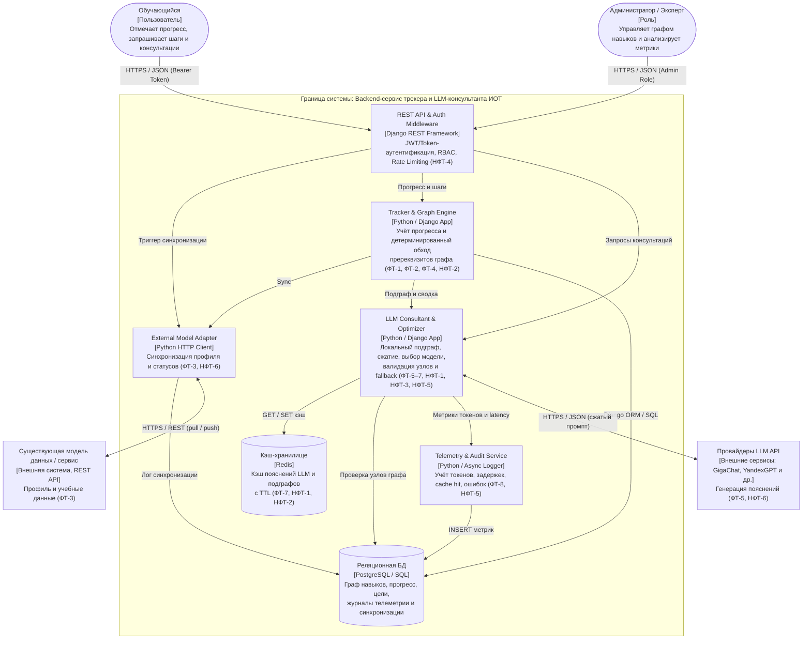
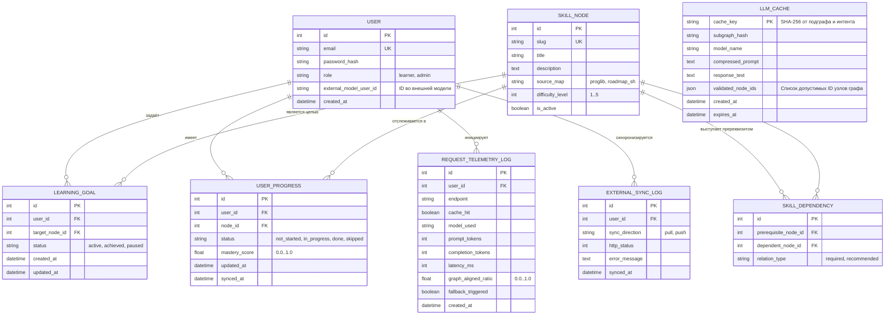
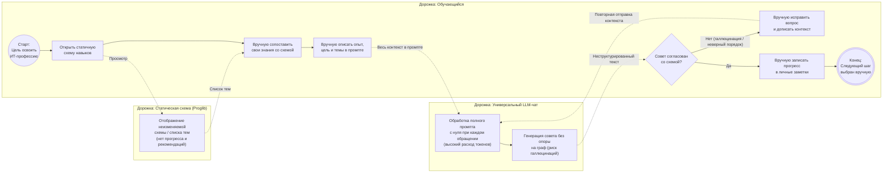
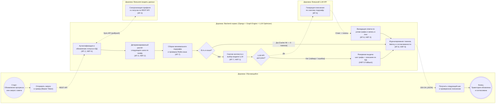

# Лабораторная работа №3. Проектирование информационных систем

**Тема ВКР:** Разработка backend-сервиса трекера и LLM-консультанта по индивидуальной образовательной траектории в ИТ на основе графа навыков с оптимизацией производительности и расхода токенов.

**Технологический стек и интеграции:** Python, Django / Django REST Framework, PostgreSQL (SQL), Redis, REST API существующей модели данных, провайдеры LLM API (GigaChat, YandexGPT и др.).

---

## 1. Вводная часть: требования к разрабатываемой системе

Проектируемый backend-сервис объединяет детерминированную навигацию по направленному графу навыков (на базе схемы Proglib и открытых карт roadmap.sh), хранение профиля и прогресса обучающегося, интеграцию с существующей моделью данных и LLM-консультанта с измеримой экономией токенов и времени отклика. Ниже сформулированы восемь функциональных (ФТ-1–ФТ-8) и шесть нефункциональных (НФТ-1–НФТ-6) требований, которые явно отражаются в проектных моделях.

### 1.1. Функциональные требования (ФТ)

- **ФТ-1. Управление графом навыков и зависимостями.** Система должна хранить в реляционной БД направленный граф навыков и тем (на основе схемы Proglib и карт roadmap.sh) с описаниями узлов, уровнем сложности и связями пререквизитов.
- **ФТ-2. Ведение профиля, цели и прогресса пользователя.** Система должна поддерживать учёт пользователей, фиксацию целевой ИТ-траектории и обновление статуса освоения каждого узла графа («не начато», «в процессе», «освоено», «пропущено»).
- **ФТ-3. Интеграция с существующей моделью данных.** Система должна обеспечивать обмен данными о профиле и прогрессе с существующей моделью данных или внешним сервисом через программный интерфейс (REST API).
- **ФТ-4. Детерминированный расчёт следующего шага.** Система должна алгоритмически вычислять следующие рекомендуемые узлы траектории путём обхода графа навыков с учётом цели пользователя, текущего прогресса и выполненных пререквизитов без обращения к LLM.
- **ФТ-5. Консультирование и объяснение рекомендаций через LLM.** Система должна формировать пояснения к рекомендованным шагам и отвечать на вопросы пользователя через API LLM (GigaChat, YandexGPT и др.), передавая минимальный контекст — локальный подграф и краткую сводку прогресса.
- **ФТ-6. Ограничение рекомендаций узлами графа (валидация ответов LLM).** Система должна проверять ответы LLM и ограничивать выдаваемые рекомендации существующими узлами графа навыков для снижения риска галлюцинаций.
- **ФТ-7. Оптимизация обращений к LLM.** Система должна применять кэширование типовых ответов, сжатие передаваемого контекста и выбор подходящей языковой модели (маршрутизацию/каскад) для сокращения расхода токенов и задержек.
- **ФТ-8. Сбор телеметрии и метрик эффективности.** Система должна фиксировать по каждому запросу число входных и выходных токенов, время отклика, факт попадания в кэш и долю рекомендаций, согласованных с графом, для оценки эффекта оптимизации до и после.

### 1.2. Нефункциональные требования (НФТ)

- **НФТ-1. Экономичность по расходу токенов.** Средний расход токенов на запрос к LLM-консультанту должен быть ниже по сравнению с базовым подходом, при котором весь контекст передаётся в промпт целиком.
- **НФТ-2. Производительность и время отклика.** Система должна обеспечивать снижение задержки отклика при обращении к консультанту по сравнению с базовым подходом, а расчёт следующего шага по графу должен выполняться локально в SQL БД без ожидания внешних сетевых вызовов к LLM.
- **НФТ-3. Согласованность и достоверность рекомендаций.** Рекомендации шагов обучения должны соответствовать структуре и пререквизитам графа навыков, минимизируя галлюцинации и несогласованные советы.
- **НФТ-4. Безопасность и разграничение доступа.** Доступ к API должен защищаться аутентификацией (JWT/Token) и авторизацией с изоляцией прогресса разных пользователей, разделением ролей (обучающийся / администратор графа), ограничением частоты запросов (rate limiting) и безопасным хранением ключей внешних API.
- **НФТ-5. Отказоустойчивость и наблюдаемость.** При недоступности или превышении таймаута внешнего LLM API трекер должен сохранять работоспособность (возвращать детерминированный шаг из графа и базовое описание узла из БД), а все ошибки, вызовы и метрики должны журналироваться.
- **НФТ-6. Интегрируемость и технологическая совместимость.** Backend-сервис должен быть реализован на стеке Python, Django и SQL с унифицированным адаптером для подключения различных LLM API (GigaChat, YandexGPT и др.) и внешним REST API для связи с существующей моделью данных.

---

## 2. Краткий обзор существующих нотаций проектирования

Ниже приведено сравнительное описание девяти распространённых нотаций и видов диаграмм проектирования информационных систем (Таблица 1).

**Таблица 1 – Сравнительный обзор нотаций и видов диаграмм проектирования ИС**

| Нотация / диаграмма | Что описывает | Сильные стороны в проектировании ИС |
| :--- | :--- | :--- |
| **BPMN 2.0** | Бизнес-процессы, роли/участников (пулы и дорожки), события, шлюзы ветвления и обмен сообщениями | Единый стандарт, понятный заказчику и разработчику; наглядно выявляет узкие места, ручные операции и оптимален для сравнения моделей AS-IS и TO-BE |
| **IDEF0** | Функциональную структуру системы через блоки с входами, выходами, управлением и механизмами (ICOM) | Позволяет выполнять строгую иерархическую декомпозицию сложных функций сверху вниз с явной фиксацией нормативных ограничений и ресурсов |
| **ER-модель («Воронья лапка»)** | Структуру данных: сущности, атрибуты, первичные и внешние ключи, связи и их кратность | Напрямую отображается в схему реляционной БД (SQL / Django ORM), позволяет заранее проверить нормализацию, целостность и хранение графовых связей |
| **DFD (Data Flow Diagram)** | Потоки данных между внешними сущностями, процессами преобразования и хранилищами | Помогает проследить движение и трансформацию данных в системе, выявить избыточные передачи и точки дублирования информации |
| **UML Use Case** | Границы системы, внешних акторов (роли) и перечень пользовательских сценариев | Фиксирует функциональный охват системы на раннем этапе и позволяет быстро проверить полноту покрытия пользовательских ролей и прав доступа |
| **UML Sequence** | Хронологическое взаимодействие компонентов, сервисов и внешних API через обмен сообщениями | Точно отражает порядок вызовов, ветвления (`alt`/`opt`), работу кэша, таймауты, валидацию ответов и механизмы отказоустойчивости |
| **UML Component** | Модульную организацию программного обеспечения, интерфейсы и зависимости между подсистемами | Упрощает проектирование слабой связанности, адаптеров и границ между модулями backend-приложения |
| **C4-модель** | Многоуровневую архитектуру ПО — от внешнего окружения до контейнеров, компонентов и кода | Снимает перегруженность классических архитектурных схем за счёт иерархии уровней; ясно показывает технологический стек, протоколы и внешние интеграции |
| **DMN (Decision Model)** | Формализованные правила принятия решений в виде таблиц решений и графов зависимостей | Отделяет бизнес-правила (пороги, маршрутизацию моделей) от кода и схемы процесса, делая логику решений прозрачной и легко изменяемой |

---

## 3. Подбор и обоснование нотаций для ВКР

С учётом специфики ВКР — гибридного backend-сервиса (Python, Django, SQL, Redis) с графом навыков, внешними интеграциями и оптимизацией LLM-запросов — выбраны **четыре взаимодополняющие нотации**:

1. **BPMN 2.0 (бизнес-логика и процессы AS-IS / TO-BE).** Отражает сквозную логику построения и сопровождения образовательной траектории, распределение ответственности между обучающимся, сервисом и внешними системами, а также наглядно демонстрирует переход от ручного процесса (AS-IS) к автоматизированному (TO-BE).
2. **C4-модель уровня контейнеров (архитектура, границы и потоки данных).** Отображает состав сервисов и хранилищ, технологический стек (Django, PostgreSQL, Redis), границы безопасности (JWT/RBAC), а также протоколы взаимодействия с существующей моделью данных и провайдерами LLM API.
3. **ER-модель в нотации «Воронья лапка» (структура данных и модель БД).** Задаёт реляционную схему в SQL/Django: хранение направленного графа навыков с пререквизитами, прогресса пользователя, привязки к внешней модели, кэша ответов и журналов телеметрии и синхронизации.
4. **UML Sequence Diagram (взаимодействие компонентов во времени).** Детализирует критический путь обработки запроса консультанта: проверку прав, синхронизацию, детерминированный расчёт следующего шага, обращение к Redis-кэшу, сжатие контекста и выбор LLM, валидацию ответа по узлам графа, резервный сценарий при сбое LLM и журналирование токенов и задержек.

Связь выбранных нотаций с требованиями представлена в Таблице 2.

**Таблица 2 – Матрица трассируемости требований к выбранным нотациям проектирования**

| Требование | BPMN 2.0 | C4 (Containers) | ER-модель | UML Sequence | Как проверяется выполнение требования в моделях |
| :--- | :---: | :---: | :---: | :---: | :--- |
| **ФТ-1** (Граф навыков) | — | + | **+ (осн.)** | + | Сущности `SKILL_NODE` и `SKILL_DEPENDENCY` в ER-модели; модуль `Graph Engine` в C4 |
| **ФТ-2** (Профиль, цель, прогресс) | + | + | **+ (осн.)** | + | Таблицы `USER`, `LEARNING_GOAL`, `USER_PROGRESS` в ER-модели; шаги обновления статуса в BPMN |
| **ФТ-3** (Связь с внешней моделью) | + | **+ (осн.)** | + | + | Внешний контейнер и `External Model Adapter` в C4; `external_model_user_id` и `EXTERNAL_SYNC_LOG` в ER |
| **ФТ-4** (Детерминированный шаг) | **+ (осн.)** | + | + | **+ (осн.)** | Отдельный локальный шаг расчёта по графу до обращения к LLM в BPMN и UML Sequence |
| **ФТ-5** (LLM-консультант с подграфом) | **+ (осн.)** | + | — | **+ (осн.)** | Формирование минимального подграфа и сводки прогресса в UML Sequence и BPMN TO-BE |
| **ФТ-6** (Ограничение узлами графа) | + | + | + | **+ (осн.)** | Блок валидации ответа LLM по списку допустимых `node_id` в UML Sequence и BPMN TO-BE |
| **ФТ-7** (Кэш, сжатие, выбор модели) | + | **+ (осн.)** | + | **+ (осн.)** | Контейнер Redis и таблица `LLM_CACHE`, ветка `Cache Hit / Miss`, сжатие промпта и маршрутизация модели |
| **ФТ-8** (Телеметрия и оценка) | + | + | **+ (осн.)** | **+ (осн.)** | Сущность `REQUEST_TELEMETRY_LOG` в ER; запись токенов, задержек и согласованности в Sequence |
| **НФТ-1** (Экономия токенов) | + | + | + | **+ (осн.)** | Отказ от полного контекста: кэш (0 токенов) + локальный подграф + сжатие промпта + учёт `prompt_tokens` |
| **НФТ-2** (Производительность) | + | **+ (осн.)** | + | + | Локальный расчёт шага в SQL, быстрый ответ из Redis при `Cache Hit`, асинхронная запись логов |
| **НФТ-3** (Достоверность) | + | — | + | **+ (осн.)** | Детерминированный выбор узла + пост-валидация ответа LLM + метрика `graph_aligned_ratio` |
| **НФТ-4** (Безопасность и доступ) | — | **+ (осн.)** | + | + | Слой `Auth & RBAC Middleware` в C4, проверка токена в Sequence, поле `role` и привязка записей к `user_id` в ER |
| **НФТ-5** (Отказоустойчивость и логи) | + | + | + | **+ (осн.)** | Ветка `fallback` при таймауте LLM API в Sequence и BPMN TO-BE; таблицы `REQUEST_TELEMETRY_LOG` и `EXTERNAL_SYNC_LOG` |
| **НФТ-6** (Стек и интегрируемость) | — | **+ (осн.)** | + | — | Явное указание Python/Django, SQL, REST API и унифицированного LLM Adapter в C4 |

---

## 4. Проектирование системы

### 4.1. Архитектура контейнеров и потоков данных (C4-модель, уровень Containers)

Диаграмма контейнеров (Рисунок 1) фиксирует границы системы, технологический стек (Python/Django, PostgreSQL, Redis), механизмы контроля доступа (НФТ-4), отказоустойчивое логирование (НФТ-5) и внешние интеграции (ФТ-3, НФТ-6).



*Рисунок 1 – C4-модель (уровень Containers): архитектура backend-сервиса и потоки данных*

**Ключевые архитектурные решения:**

- Разделение `Tracker & Graph Engine` и `LLM Consultant` гарантирует, что базовый трекер и расчёт следующего шага работают детерминированно на уровне SQL без зависимости от доступности LLM (ФТ-4, НФТ-2, НФТ-5).
- Единая точка входа через `REST API & Auth Middleware` обеспечивает проверку токена, ролей RBAC и изоляцию данных по `user_id` (НФТ-4).
- Слой `RedisCache` в связке с модулем сжатия контекста и маршрутизации моделей напрямую обеспечивает снижение расхода токенов и задержек (ФТ-7, НФТ-1, НФТ-2).

---

### 4.2. Логическая модель данных (ER-диаграмма)

Логическая модель данных в нотации «Воронья лапка» (Рисунок 2) описывает структуру реляционной БД (SQL / Django ORM) для хранения направленного графа навыков с пререквизитами, пользовательского прогресса, сведений для синхронизации, кэша и журналов телеметрии.



*Рисунок 2 – ER-модель реляционной базы данных backend-сервиса (нотация «Воронья лапка»)*

**Отражение требований в модели данных:**

- Направленный граф навыков моделируется связью многие-ко-многим через таблицу рёбер `SKILL_DEPENDENCY` (`prerequisite_node_id` → `dependent_node_id`), что позволяет строго проверять выполнение пререквизитов при расчёте следующего шага (ФТ-1, ФТ-4, НФТ-3).
- Поле `external_model_user_id` в `USER`, метка `synced_at` в `USER_PROGRESS` и журнал `EXTERNAL_SYNC_LOG` обеспечивают прозрачную интеграцию с существующей моделью данных и аудит ошибок синхронизации (ФТ-3, НФТ-5).
- Таблица `LLM_CACHE` (персистентная копия кэша с TTL и полем `validated_node_ids`) и журнал `REQUEST_TELEMETRY_LOG` фиксируют все целевые метрики исследования: число токенов, задержку, `cache_hit`, долю согласованных с графом рекомендаций и срабатывание резервного режима (ФТ-7, ФТ-8, НФТ-1–НФТ-3, НФТ-5).
- Поле `role` и обязательная связка по `user_id` поддерживают разграничение доступа (НФТ-4).

---

### 4.3. Сценарий взаимодействия компонентов (UML Sequence Diagram)

Диаграмма последовательностей (Рисунок 3) детализирует ключевой сценарий работы системы — расчёт следующего шага траектории и получение пояснения от LLM-консультанта с учётом аутентификации, условной синхронизации, кэширования, сжатия контекста, валидации ссылок на узлы графа, отказоустойчивой деградации и телеметрии.

```mermaid
sequenceDiagram
    autonumber
    actor Client as Обучающийся (Клиент)
    participant API as Django API & Auth
    participant Sync as Integration Adapter
    participant Ext as Существующая модель
    participant Graph as Graph Engine
    participant DB as SQL DB
    participant Opt as LLM Optimizer & Validator
    participant Cache as Redis Cache
    participant LLM as LLM API (GigaChat/YandexGPT)
    participant Log as Telemetry Logger

    Client->>API: POST /api/v1/recommendations/explain (Bearer Token, question)
    API->>API: Проверка токена, роли RBAC и rate limit (НФТ-4)

    opt Данные прогресса устарели (TTL истёк)
        API->>Sync: Запросить синхронизацию прогресса (ФТ-3)
        Sync->>Ext: GET /external/learner/{id}/progress
        Ext-->>Sync: Актуальные статусы навыков (JSON)
        Sync->>DB: Обновить USER_PROGRESS и записать EXTERNAL_SYNC_LOG
    end

    API->>Graph: Рассчитать следующий шаг для user_id (ФТ-4)
    Graph->>DB: Загрузить LEARNING_GOAL, USER_PROGRESS, SKILL_DEPENDENCY
    DB-->>Graph: Данные цели, прогресса и графа
    Graph->>Graph: Детерминированный обход графа (проверка пререквизитов, НФТ-2)
    Graph-->>API: next_nodes + минимальный локальный подграф + сводка прогресса

    API->>Opt: Получить пояснение (next_nodes, subgraph, summary, question)
    Opt->>Opt: Сформировать cache_key (SHA-256 подграфа и интента)
    Opt->>Cache: GET cache_key

    alt Cache Hit (найдено в кэше — ФТ-7, НФТ-1, НФТ-2)
        Cache-->>Opt: Валидированное пояснение (0 токенов LLM)
        Opt-->>API: Пояснение + cache_hit=true
    else Cache Miss (нужен вызов LLM)
        Opt->>Opt: Сжатие контекста и выбор модели по сложности вопроса (ФТ-7, НФТ-1)
        Opt->>LLM: Запрос со сжатым подграфом и списком допустимых node_id (ФТ-5)

        alt LLM API ответил в пределах таймаута
            LLM-->>Opt: Текст ответа + статистика токенов
            Opt->>Opt: Валидация ссылок на узлы графа (ФТ-6, НФТ-3)
            opt Обнаружены несогласованные рекомендации
                Opt->>Opt: Отфильтровать узлы вне графа и скорректировать ссылки
            end
            Opt->>Cache: SET cache_key (TTL)
            Opt-->>API: Валидированное пояснение + метрики токенов
        else Таймаут или 5xx ошибка LLM API (Graceful Degradation — НФТ-5)
            LLM--xOpt: Timeout / 5xx Error
            Opt-->>API: Детерминированный шаг + описание узла из БД (fallback=true)
        end
    end

    API--)Log: Асинхронная запись (tokens, latency_ms, cache_hit, aligned_ratio, fallback) (ФТ-8)
    Log->>DB: INSERT INTO REQUEST_TELEMETRY_LOG
    API-->>Client: 200 OK (next_nodes, explanation, graph_refs)
```

*Рисунок 3 – UML Sequence Diagram: расчёт следующего шага и получение пояснения от LLM-консультанта*

---

## 5. Сравнение процессов AS-IS и TO-BE (в нотации BPMN 2.0)

### 5.1. Модель AS-IS («как сейчас» — без разрабатываемой системы)

В текущем процессе (Рисунок 4) обучающийся вручную совмещает статичную карту навыков (схему Proglib) и универсальные LLM-чаты (ChatGPT, GigaChat, YandexGPT), которые не хранят прогресс, требуют повторной передачи контекста при каждом обращении и не гарантируют согласованности рекомендаций со схемой.



*Рисунок 4 – BPMN 2.0: модель текущего процесса AS-IS без разрабатываемого сервиса*

**Ключевые проблемы AS-IS:**

- Отсутствует автоматический учёт прогресса и проверка пререквизитов — всё выполняется вручную по статичной схеме.
- При каждом новом запросе в LLM-чат контекст приходится передавать повторно, что приводит к избыточному расходу токенов и росту задержек.
- LLM без структурной опоры склонна к галлюцинациям и неустойчивым оценкам уровня знаний, что порождает ручные циклы перепроверки.
- Нет связи с существующей моделью данных и нет объективных метрик качества и стоимости рекомендаций.

---

### 5.2. Модель TO-BE («как должно быть» — с разработанным backend-сервисом)

В целевом процессе TO-BE (Рисунок 5) детерминированная навигация по графу, синхронизация с внешней моделью, кэширование в Redis, сжатие контекста, валидация ответов LLM, резервная выдача при сбое API и сбор телеметрии автоматизированы внутри backend-сервиса.



*Рисунок 5 – BPMN 2.0: целевая модель процесса TO-BE с разработанным backend-сервисом*

---

### 5.3. Как проектные решения обеспечивают переход от AS-IS к TO-BE

Сопоставление процессов AS-IS и TO-BE приведено в Таблице 3.

**Таблица 3 – Сопоставление процессов AS-IS и TO-BE и обеспечивающие проектные решения**

| Аспект процесса | Состояние AS-IS | Состояние TO-BE | Проектное решение, обеспечивающее переход |
| :--- | :--- | :--- | :--- |
| **Выбор следующего шага** | Ручной анализ статичной схемы Proglib | Автоматический детерминированный расчёт за миллисекунды | Граф `SKILL_NODE` + `SKILL_DEPENDENCY` в SQL и алгоритм обхода в `Graph Engine` (ФТ-1, ФТ-4, НФТ-2) |
| **Учёт прогресса и данных** | Личные заметки, нет связи с внешней моделью | Централизованное хранение в БД и API-синхронизация | Сущность `USER_PROGRESS` и `External Model Adapter` (ФТ-2, ФТ-3, НФТ-6) |
| **Расход токенов и задержки** | Повторная передача всего контекста в чат при каждом запросе | Передача только локального подграфа, сжатие промпта, кэширование и выбор модели | Модуль `LLM Optimizer`, кэш `Redis` и таблица `LLM_CACHE` (ФТ-7, НФТ-1, НФТ-2) |
| **Надёжность и галлюцинации** | Неконтролируемые советы LLM, возможен сбой при недоступности чата | Проверка ссылок на узлы графа + резервная выдача без LLM | Валидатор узлов и ветка `graceful degradation` в `LLM Consultant` (ФТ-6, НФТ-3, НФТ-5) |
| **Контроль эффективности** | Отсутствует | Измеримые метрики по каждому запросу | `Telemetry Service` и таблица `REQUEST_TELEMETRY_LOG` (ФТ-8, НФТ-5) |

---

## 6. Обоснование и выводы

1. **Адекватность выбранных нотаций предметной области и целям ВКР.** Цель ВКР заключается не просто в подключении LLM, а в создании гибридного backend-сервиса с детерминированной графовой логикой, внешней интеграцией и измеримой экономией токенов и времени отклика. Выбранная четвёрка нотаций покрывает предметную область без пробелов и дублирования: **BPMN 2.0** фиксирует бизнес-процесс и ценность автоматизации, **C4** закрепляет архитектурные границы и стек (Django, PostgreSQL, Redis, внешние API), **ER-модель** формализует граф навыков и таблицы метрик, а **UML Sequence** раскрывает динамику оптимизации и отказоустойчивости в реальном времени.
2. **Подтверждение выполнения ключевых требований.** Все восемь функциональных (ФТ-1–ФТ-8) и шесть нефункциональных требований (НФТ-1–НФТ-6) явно прослежены до конкретных элементов моделей (Таблица 2): разделение детерминированного обхода графа и генерации пояснений подтверждает снижение риска галлюцинаций и времени отклика (НФТ-2, НФТ-3), ветка `Cache Hit / Miss` со сжатием подграфа и выбором модели подтверждает экономию токенов (НФТ-1), middleware и привязка записей к `user_id` закрывают безопасность (НФТ-4), а ветка резервной выдачи и таблицы логов обеспечивают отказоустойчивость и наблюдаемость (НФТ-5).
3. **Наглядный эффект перехода к TO-BE.** На диаграммах BPMN 2.0 (Рисунки 4 и 5) и в Таблице 3 показано, что в модели TO-BE из процесса полностью исключены три ручных цикла обучающегося (ручной анализ схемы, многократный пересказ контекста в чат и ручная перепроверка галлюцинаций), а на ветке попадания в кэш обращение к внешнему LLM API вообще не выполняется (0 токенов LLM), что даёт максимальную экономию токенов и минимальную задержку отклика.
4. **Итог этапа проектирования — согласованность моделей.** Проектирование подтвердило сквозную согласованность процессов, данных и взаимодействий: одни и те же сущности (`SKILL_NODE`, `SKILL_DEPENDENCY`, `USER_PROGRESS`, `LLM_CACHE`, `REQUEST_TELEMETRY_LOG`), роли (`learner`, `admin`), статусы прогресса и точки интеграции единообразно проходят через все четыре диаграммы. Полученная проектная спецификация напрямую переводится в модели Django ORM, маршруты REST API и методику нагрузочных замеров токенов и задержек на этапе реализации ВКР.
