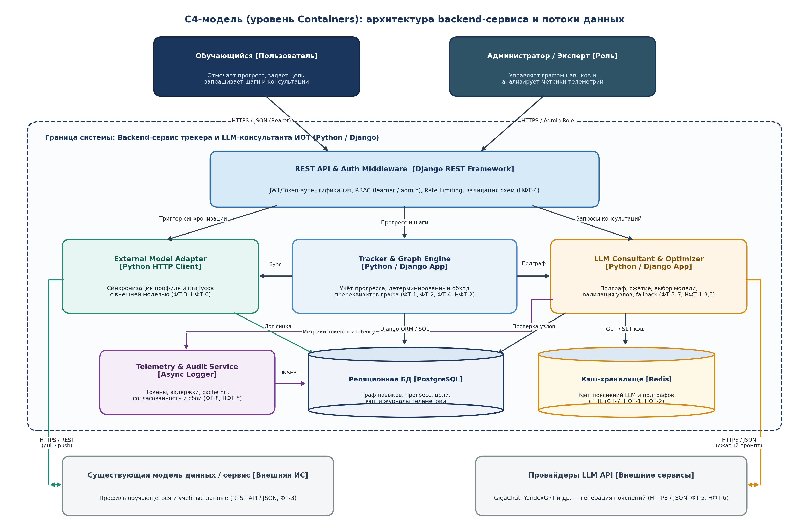
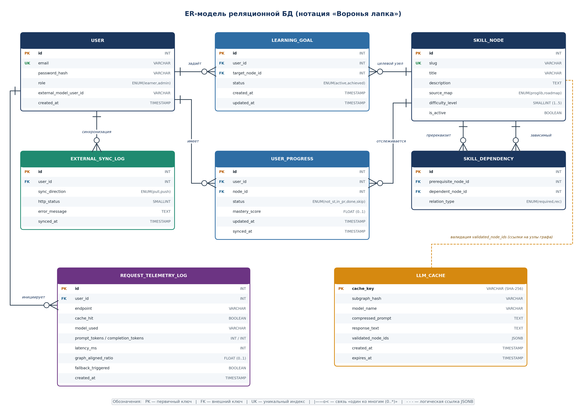
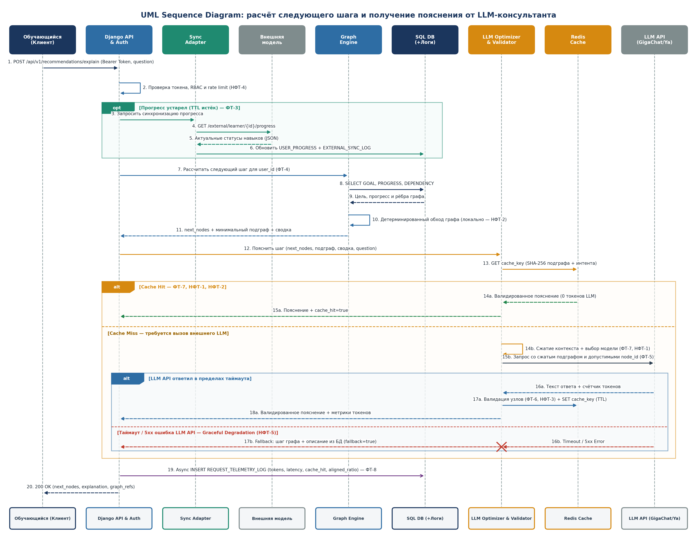
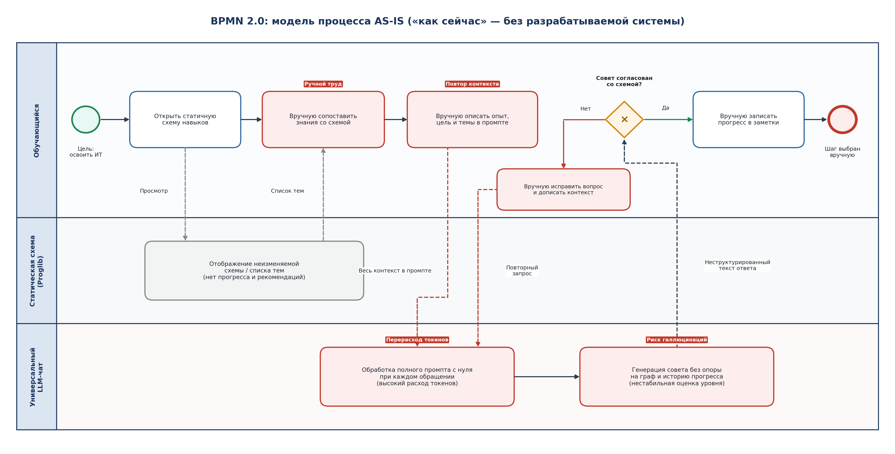
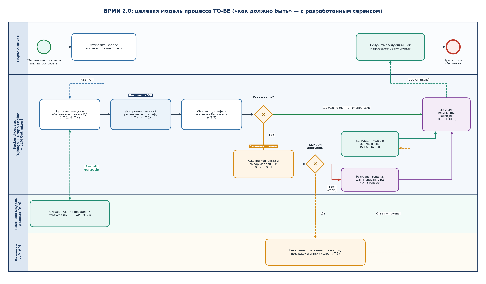

# Итоговый отчёт за 7 семестр (первая половина ВКР)

**Тема ВКР:** Разработка backend-сервиса трекера и LLM-консультанта по индивидуальной образовательной траектории в ИТ на основе графа навыков с оптимизацией производительности и расхода токенов  
**Автор:** Смирнов Георгий Валерьевич (Университет ИТМО, Факультет прикладной информатики)  
**Научный руководитель:** Говоров Антон Игоревич, старший преподаватель, факультет прикладной информатики

---

## СОДЕРЖАНИЕ

- [СПИСОК СОКРАЩЕНИЙ И УСЛОВНЫХ ОБОЗНАЧЕНИЙ](#список-сокращений-и-условных-обозначений)
- [ВВЕДЕНИЕ](#введение)
- [1 АНАЛИЗ ПРЕДМЕТНОЙ ОБЛАСТИ И ПОСТАНОВКА ЗАДАЧИ](#1-анализ-предметной-области-и-постановка-задачи)
  - [1.1 Обзор научно-технической литературы и существующих подходов](#11-обзор-научно-технической-литературы-и-существующих-подходов)
  - [1.2 Сравнительный анализ аналогичных решений](#12-сравнительный-анализ-аналогичных-решений)
  - [1.3 Формулировка функциональных и нефункциональных требований](#13-формулировка-функциональных-и-нефункциональных-требований)
- [2 ПРОЕКТИРОВАНИЕ АРХИТЕКТУРЫ И МОДЕЛЕЙ СИСТЕМЫ](#2-проектирование-архитектуры-и-моделей-системы)
  - [2.1 Выбор и обоснование нотаций проектирования](#21-выбор-и-обоснование-нотаций-проектирования)
  - [2.2 Архитектурная модель контейнеров и потоков данных](#22-архитектурная-модель-контейнеров-и-потоков-данных)
  - [2.3 Логическая модель реляционной базы данных](#23-логическая-модель-реляционной-базы-данных)
  - [2.4 Сценарий взаимодействия компонентов системы](#24-сценарий-взаимодействия-компонентов-системы)
  - [2.5 Сравнительное моделирование процессов до и после внедрения](#25-сравнительное-моделирование-процессов-до-и-после-внедрения)
  - [2.6 Обоснование выбора технологического стека и контракта программного интерфейса](#26-обоснование-выбора-технологического-стека-и-контракта-программного-интерфейса)
- [ЗАКЛЮЧЕНИЕ ПО ИТОГАМ ПЕРВОГО ЭТАПА](#заключение-по-итогам-первого-этапа)
- [СПИСОК ИСПОЛЬЗОВАННЫХ ИСТОЧНИКОВ](#список-использованных-источников)
- [ПРИЛОЖЕНИЕ А. Техническое задание на разработку сервиса](#приложение-а-техническое-задание-на-разработку-сервиса)

---

## СПИСОК СОКРАЩЕНИЙ И УСЛОВНЫХ ОБОЗНАЧЕНИЙ

- **API** — программный интерфейс приложения (Application Programming Interface)
- **BPMN** — нотация моделирования бизнес-процессов (Business Process Model and Notation)
- **DAG** — направленный ациклический граф (Directed Acyclic Graph)
- **ER** — модель «сущность–связь» (Entity–Relationship)
- **JWT** — веб-токен в формате JSON (JSON Web Token)
- **LLM** — большая языковая модель (Large Language Model)
- **ORM** — объектно-реляционное отображение (Object-Relational Mapping)
- **RAG** — генерация, дополненная извлечением знаний (Retrieval-Augmented Generation)
- **RBAC** — ролевое управление доступом (Role-Based Access Control)
- **REST** — передача состояния представления (Representational State Transfer)
- **SQL** — язык структурированных запросов (Structured Query Language)
- **TTL** — время жизни записи в кэше (Time To Live)
- **UML** — унифицированный язык моделирования (Unified Modeling Language)
- **БД** — база данных
- **ВКР** — выпускная квалификационная работа
- **ИОТ** — индивидуальная образовательная траектория
- **ИТ** — информационные технологии
- **НФТ** — нефункциональное требование
- **ФТ** — функциональное требование

---

## ВВЕДЕНИЕ

Рост требований к квалификации специалистов в области информационных технологий и высокая скорость обновления прикладных стеков делают востребованной персональную навигацию по обучению [4]. Открытые дорожные карты развития разработчиков — в частности схема веб-разработчика Proglib [8] и карты платформы roadmap.sh — формируют понятную структуру компетенций, однако в статичном виде не учитывают текущий прогресс и карьерную цель конкретного обучающегося. В свою очередь универсальные большие языковые модели (LLM) способны давать развёрнутые методические советы, но без структурной опоры склонны к галлюцинациям, неустойчивым оценкам уровня подготовки и несогласованным рекомендациям [4, 9].

Современные исследовательские работы подтверждают перспективность гибридных систем, объединяющих граф знаний, модель обучающегося и LLM [9, 10]. В экспериментальном исследовании [1] применение многоагентного LLM-подхода в обучении программированию сопровождалось сокращением времени выполнения заданий на 23–35 % (предварительный результат). Вместе с тем вопросы стоимости токенов и времени отклика LLM-запросов в образовательных системах практически не рассматриваются как самостоятельная инженерная цель, несмотря на наличие зрелых методов снижения издержек: генерации с дополнением извлечением (RAG), графового RAG, сжатия промптов и каскадирования моделей [13–16].

**Объект исследования** — процесс построения, отслеживания и методического сопровождения индивидуальной образовательной траектории специалиста в области ИТ.

**Предмет исследования** — архитектура, алгоритмы навигации по графу навыков и методы оптимизации производительности и расхода токенов в гибридном backend-сервисе трекера и LLM-консультанта.

**Цель исследования** — разработать backend-сервис трекера и LLM-консультанта по индивидуальной образовательной траектории в ИТ, интегрированный с существующей моделью данных, и обеспечить измеримое снижение расхода токенов и времени отклика по сравнению с базовым подходом передачи полного контекста в промпт.

**Задачи исследования:**
1. Проанализировать научно-технические подходы к построению индивидуальных образовательных траекторий и LLM-консультантов, зафиксировать критерии сравнения аналогов.
2. Спроектировать модель данных (граф навыков и тем на основе карты Proglib и roadmap.sh, профиль, цели, прогресс, связь с существующей моделью), архитектуру и процессы взаимодействия компонентов.
3. Реализовать backend-сервис (Python, Django, PostgreSQL): REST API и детерминированный алгоритм расчёта следующих шагов с учётом пререквизитов и прогресса.
4. Реализовать LLM-консультанта с передачей минимального контекста (локальный подграф и краткая сводка прогресса) и пост-валидацией рекомендаций по узлам графа для снижения галлюцинаций.
5. Внедрить механизмы оптимизации производительности и расхода токенов (кэширование в Redis, сжатие контекста, маршрутизация моделей) и измерить эффект до и после.
6. Провести экспериментальную оценку решения по расходу токенов, времени отклика, доле рекомендаций, согласованных с графом, а также пилотное тестирование.

**Практическая значимость работы** заключается в создании воспроизводимого гибридного backend-сервиса, пригодного для интеграции с существующими образовательными моделями и демонстрирующего измеримую экономию вычислительных ресурсов при сохранении высокой достоверности рекомендаций. В рамках 7 семестра выполнены задачи 1 и 2 — проведено исследование предметной области, сформированы требования, выполнена полная стадия проектирования системы и подготовлено техническое задание на реализацию.

---

## 1 АНАЛИЗ ПРЕДМЕТНОЙ ОБЛАСТИ И ПОСТАНОВКА ЗАДАЧИ

### 1.1 Обзор научно-технической литературы и существующих подходов

Исследования в области персонализированных образовательных траекторий и интеллектуальных обучающих систем развиваются на стыке моделирования знаний, графовых структур и больших языковых моделей.

Основополагающая работа К. Пича и соавторов *Deep Knowledge Tracing* [12] заложила нейросетевой подход к оценке уровня усвоения знаний обучающимся. Развивая данное направление, Ю. Линь и Ч. У предложили метод LPReKL [9], объединяющий оценку знаний и LLM; авторы показали, что сама по себе языковая модель оценивает знания консервативно и склонна к галлюцинациям, а передача всех связей динамического графа знаний в промпт нецелесообразна. В работе Т. Вана, Х. Сюна и коллег (HKUST-GZ, Microsoft) представлена внедрённая на практике мультиагентная система GenMentor [10], преобразующая цель обучающегося в перечень навыков, пробелы и план изучения. Исследователи Университета Зигена (Х. Абу-Рашид, К. Вебер, М. Фатхи и др.) продемонстрировали применение LLM для достраивания графа знаний учебных курсов и его сопоставления с моделью пользователя [11]. Обзорная публикация [17] дополнительно акцентирует проблемы интерпретируемости и управляемости LLM в образовательных сценариях.

Среди отечественных и русскоязычных работ ключевое значение имеют исследования А. Н. Тимофеева и соавторов [1, 2], предложивших многоагентные LLM-модели корректировки сценария изучения программирования с использованием Graph RAG и выявлением деструктивных факторов обучения. В работе О. В. Тарасова [3] показано, что представление контента графом микромодулей недостаточно без учёта данных о прогрессе обучающегося. Д. С. Потоцкий и К. А. Павлюченко [4] описали gap-анализ компетентностных дефицитов в ИТ (порог усвоения 70 %) с последующим синтезом материалов через LLM, прямо указав на риск галлюцинаций и необходимость контроля. Терминологическая основа ИОТ и адаптивного обучения закреплена в трудах Т. М. Шамсутдиновой [5] и К. Л. Бугайчука [6], а связь образовательных программ с требованиями рынка труда на базе языковых моделей исследована в диссертации Д. С. Ботова [7].

Для решения инженерной задачи снижения затрат на инференс и задержек отклика релевантны методы извлечения релевантного контекста RAG [13] и GraphRAG [15], алгоритмы сжатия промптов LLMLingua (позволяющие существенно сокращать длину входа при малой потере качества) [14] и каскады моделей FrugalGPT, маршрутизирующие запросы между моделями разной стоимости [16].

**Основные выводы по обзору литературы:**
- современные системы персонализации опираются на три элемента: граф навыков, модель прогресса обучающегося и LLM-слой объяснений;
- использование LLM без графовой опоры ненадёжно из-за галлюцинаций, что обосновывает гибридную схему с детерминированным расчётом шага по графу;
- открытые карьерные карты вроде схемы Proglib [8] и roadmap.sh редко используются в отечественных исследованиях как формализованный граф навыков с программным API;
- оптимизация расхода токенов и задержек отклика в образовательных LLM-системах остаётся слабо проработанным пробелом, который закрывает данная ВКР.

### 1.2 Сравнительный анализ аналогичных решений

Для позиционирования разрабатываемого сервиса проанализированы прямые аналоги — платформа **roadmap.sh**, статическая схема **Proglib** [8], исследовательские системы **GenMentor** [10] и **LPReKL** [9], — а также косвенные аналоги: универсальные LLM-чаты (**ChatGPT, GigaChat, YandexGPT**) и образовательные платформы с ИИ-ассистентами (например, Coursera). Результаты сопоставления представлены в Таблице 1.

**Таблица 1 – Сравнение существующих аналогов и предлагаемого решения**

| Критерий сравнения | roadmap.sh | Статическая схема (Proglib) | GenMentor | LPReKL | LLM-чаты общего назначения | Предлагаемое решение |
| :--- | :--- | :--- | :--- | :--- | :--- | :--- |
| Структурированная карта навыков с зависимостями | Да | Частично (статичная схема) | Частично (цель → навыки) | Частично (концепты курса) | Нет | Да (граф в БД) |
| Отслеживание прогресса пользователя | Да (done / learning / skipped) | Нет | Да | Да (knowledge tracing) | Нет (без внешнего хранилища) | Да |
| Алгоритмический расчёт следующего шага | Частично (вручную / AI) | Нет | Да | Да | Частично (без гарантии согласованности) | Да (обход графа + прогресс) |
| LLM-консультант с объяснением рекомендаций | Да (AI Tutor) | Нет | Да | Частично (задания) | Да | Да |
| Связь с существующей моделью данных (API) | Нет (замкнутая платформа) | Нет | Не заявлено | Не заявлено | Нет | Да |
| Оптимизация токенов и производительности как цель | Не заявлено | Не применимо | Не заявлено | Не заявлено | Нет | Да (ключевой критерий) |
| Доступность и открытость | Частично (MIT + Premium) | Да | Частично (GitHub) | Не заявлено | Частично (лимиты, тарифы) | Да (собственная реализация) |

Анализ Таблицы 1 показывает, что ни один из рассмотренных аналогов не объединяет одновременно карьерный граф ИТ-навыков в реляционной БД, учёт прогресса, подключение к существующей модели данных по API, LLM-консультанта с контролем галлюцинаций и измеримую оптимизацию расхода токенов и задержек.

### 1.3 Формулировка функциональных и нефункциональных требований

На основе анализа предметной области сформулированы требования к проектируемому backend-сервису.

**Функциональные требования:**
- **ФТ-1. Управление графом навыков и зависимостями:** хранение в реляционной БД направленного графа навыков (на базе Proglib и roadmap.sh) с описаниями узлов, уровнем сложности и связями пререквизитов.
- **ФТ-2. Ведение профиля, цели и прогресса:** регистрация и учёт пользователей, установка целевого узла траектории и обновление статуса освоения тем («не начато», «в процессе», «освоено», «пропущено»).
- **ФТ-3. Интеграция с существующей моделью данных:** обмен данными о профиле и прогрессе с внешним сервисом через REST API.
- **ФТ-4. Детерминированный расчёт следующего шага:** алгоритмический обход графа навыков с проверкой пререквизитов и текущего прогресса без обращения к LLM.
- **ФТ-5. Консультирование и объяснение через LLM:** генерация пояснений через API LLM (GigaChat, YandexGPT и др.) с передачей минимального локального подграфа и краткой сводки прогресса.
- **ФТ-6. Ограничение рекомендаций узлами графа:** пост-валидация ответов LLM по списку допустимых узлов для минимизации галлюцинаций.
- **ФТ-7. Оптимизация обращений к LLM:** кэширование типовых ответов, сжатие контекста и маршрутизация между моделями разной сложности.
- **ФТ-8. Сбор телеметрии и метрик эффективности:** фиксация токенов, времени отклика, попаданий в кэш и доли согласованных с графом рекомендаций.

**Нефункциональные требования:**
- **НФТ-1 (Экономичность по токенам):** измеримое снижение среднего числа входных токенов относительно базовой передачи полного контекста.
- **НФТ-2 (Производительность):** локальный расчёт шага по графу в SQL без ожидания LLM и снижение задержки отклика консультанта.
- **НФТ-3 (Согласованность и достоверность):** строгое соответствие рекомендаций структуре и пререквизитам графа навыков.
- **НФТ-4 (Безопасность и разграничение доступа):** JWT-аутентификация, ролевая модель (`learner` / `admin`), изоляция данных пользователей и rate limiting.
- **НФТ-5 (Отказоустойчивость и наблюдаемость):** сохранение работоспособности трекера и выдача базового описания из БД при недоступности LLM API (graceful degradation), журналирование сбоев и метрик.
- **НФТ-6 (Технологическая совместимость):** стек Python, Django, PostgreSQL, Redis, унифицированный адаптер LLM-провайдеров и REST API внешней модели.

---

## 2 ПРОЕКТИРОВАНИЕ АРХИТЕКТУРЫ И МОДЕЛЕЙ СИСТЕМЫ

### 2.1 Выбор и обоснование нотаций проектирования

По результатам обзора девяти нотаций проектирования (BPMN 2.0, IDEF0, ER-модель, DFD, UML Use Case, UML Sequence, UML Component, C4-модель, DMN) для моделирования проектируемого сервиса выбран взаимодополняющий набор из четырёх нотаций:
1. **C4-модель (уровень контейнеров)** — для фиксации границ системы, технологического стека, механизмов доступа и внешних интеграций.
2. **ER-модель («Воронья лапка»)** — для проектирования реляционной схемы графа навыков, прогресса, кэша и журналов телеметрии.
3. **UML Sequence Diagram** — для детализации динамики обработки запроса, работы кэша, сжатия контекста, валидации и резервного режима.
4. **BPMN 2.0** — для формализации и сопоставления бизнес-процессов AS-IS и TO-BE.

Сводная матрица трассируемости требований к выбранным нотациям приведена в Таблице 2.

**Таблица 2 – Трассируемость функциональных и нефункциональных требований к проектным моделям**

| Требование | BPMN 2.0 | C4 (Containers) | ER-модель | UML Sequence | Отражение требования в моделях |
| :--- | :---: | :---: | :---: | :---: | :--- |
| ФТ-1 (Граф навыков) | — | + | **+ (осн.)** | + | Сущности `SKILL_NODE`, `SKILL_DEPENDENCY`; модуль `Graph Engine` |
| ФТ-2 (Профиль и прогресс) | + | + | **+ (осн.)** | + | Сущности `USER`, `LEARNING_GOAL`, `USER_PROGRESS`; шаги BPMN |
| ФТ-3 (Внешняя модель) | + | **+ (осн.)** | + | + | `External Model Adapter`, `external_model_user_id`, `EXTERNAL_SYNC_LOG` |
| ФТ-4 (Детерминированный шаг) | **+ (осн.)** | + | + | **+ (осн.)** | Локальный обход графа до вызова LLM в BPMN и Sequence |
| ФТ-5 (LLM с подграфом) | **+ (осн.)** | + | — | **+ (осн.)** | Сборка локального подграфа и краткой сводки прогресса |
| ФТ-6 (Валидация узлов) | + | + | + | **+ (осн.)** | Проверка ссылок ответа по допустимым `node_id` |
| ФТ-7 (Кэш, сжатие, выбор) | + | **+ (осн.)** | + | **+ (осн.)** | Redis и `LLM_CACHE`, ветка `Cache Hit / Miss`, маршрутизация модели |
| ФТ-8 (Телеметрия) | + | + | **+ (осн.)** | **+ (осн.)** | `REQUEST_TELEMETRY_LOG` и асинхронная запись метрик |
| НФТ-1 (Экономия токенов) | + | + | + | **+ (осн.)** | Кэш (0 токенов) + локальный подграф + сжатие промпта |
| НФТ-2 (Производительность) | + | **+ (осн.)** | + | + | Локальный обход в SQL, быстрый возврат из Redis |
| НФТ-3 (Достоверность) | + | — | + | **+ (осн.)** | Детерминированный выбор шага + пост-валидация + `graph_aligned_ratio` |
| НФТ-4 (Безопасность) | — | **+ (осн.)** | + | + | `Auth & RBAC Middleware`, проверка JWT, `role` и `user_id` |
| НФТ-5 (Отказоустойчивость) | + | + | + | **+ (осн.)** | Ветка `fallback` при таймауте LLM + журналы ошибок и телеметрии |
| НФТ-6 (Стек и адаптеры) | — | **+ (осн.)** | + | — | Python/Django, PostgreSQL, Redis, адаптеры LLM и внешней модели |

### 2.2 Архитектурная модель контейнеров и потоков данных

Архитектура контейнеров разрабатываемого сервиса представлена на Рисунке 1. Выделение модулей `Tracker & Graph Engine` и `LLM Consultant & Optimizer` гарантирует независимость расчёта траектории от внешних LLM-провайдеров, а единый вход `REST API & Auth Middleware` централизует проверку прав доступа.

*Рисунок 1 – Архитектура контейнеров и потоков данных backend-сервиса*

### 2.3 Логическая модель реляционной базы данных

Логическая структура реляционной базы данных показана на Рисунке 2. Модель включает 8 взаимосвязанных сущностей, покрывающих хранение направленного графа навыков (`SKILL_NODE`, `SKILL_DEPENDENCY`), целеполагания и прогресса (`USER`, `LEARNING_GOAL`, `USER_PROGRESS`), персистентного кэша (`LLM_CACHE`), а также аудита синхронизации (`EXTERNAL_SYNC_LOG`) и телеметрии (`REQUEST_TELEMETRY_LOG`).

*Рисунок 2 – Логическая модель реляционной базы данных backend-сервиса*

### 2.4 Сценарий взаимодействия компонентов системы

Динамика обработки пользовательского запроса на расчёт следующего шага и получение пояснения детализирована на диаграмме последовательностей (Рисунок 3). Модель явно фиксирует условную синхронизацию с внешней моделью (`opt`), альтернативные ветки попадания и промаха кэша (`alt`), пост-валидацию ссылок на узлы графа и сценарий плавной деградации при сбое LLM API.

*Рисунок 3 – Диаграмма последовательностей расчёта следующего шага и консультации*

### 2.5 Сравнительное моделирование процессов до и после внедрения

Текущий ручной процесс (модель AS-IS, Рисунок 4) характеризуется тремя неэффективными циклами: ручным сопоставлением знаний со статичной схемой, повторным вводом полного контекста в универсальные LLM-чаты и ручной перепроверкой галлюцинаций.

*Рисунок 4 – Модель текущего процесса до внедрения сервиса (AS-IS)*

Целевой процесс (модель TO-BE, Рисунок 5) переносит навигацию, синхронизацию, кэширование, сжатие контекста, валидацию ответов и сбор телеметрии на сторону backend-сервиса.

*Рисунок 5 – Целевая модель процесса с разработанным backend-сервисом (TO-BE)*

Сводное сопоставление процессов AS-IS и TO-BE представлено в Таблице 3.

**Таблица 3 – Сопоставление процессов AS-IS и TO-BE и обеспечивающие проектные решения**

| Аспект процесса | Состояние AS-IS | Состояние TO-BE | Проектное решение перехода |
| :--- | :--- | :--- | :--- |
| Выбор следующего шага | Ручной анализ статичной схемы Proglib | Автоматический детерминированный расчёт за миллисекунды | Граф `SKILL_NODE` + `SKILL_DEPENDENCY` в SQL и `Graph Engine` (ФТ-1, ФТ-4) |
| Учёт прогресса и данных | Личные заметки, нет связи с внешней моделью | Централизованное хранение и API-синхронизация | `USER_PROGRESS` и `External Model Adapter` (ФТ-2, ФТ-3) |
| Расход токенов и задержки | Повторная передача всего контекста в чат | Локальный подграф, сжатие, кэш Redis и маршрутизация | `LLM Optimizer`, Redis и таблица `LLM_CACHE` (ФТ-7, НФТ-1, НФТ-2) |
| Надёжность и галлюцинации | Неконтролируемые советы LLM, сбой при отказе чата | Валидация узлов графа + резервная выдача из БД | Валидатор узлов и `Graceful Degradation` (ФТ-6, НФТ-3, НФТ-5) |
| Контроль эффективности | Отсутствует | Измеримые метрики по каждому запросу | `Telemetry Service` и `REQUEST_TELEMETRY_LOG` (ФТ-8) |

### 2.6 Обоснование выбора технологического стека и контракта программного интерфейса

Для программной реализации выбран стек **Python 3.12 + Django / Django REST Framework + PostgreSQL + Redis**:
- **Django и DRF** обеспечивают быструю разработку защищённого REST API, встроенные миграции, RBAC и автодокументирование OpenAPI 3.0;
- **PostgreSQL** обеспечивает строгую ссылочную целостность графа зависимостей и поддержку типа `JSONB` для хранения валидированных идентификаторов узлов;
- **Redis** гарантирует субмиллисекундный доступ к кэшу пояснений и горячих подграфов с автоматическим истечением по TTL;
- **Унифицированный адаптер LLM API** позволяет подключать отечественные провайдеры (GigaChat, YandexGPT) и mock-реализации для воспроизводимых автотестов без изменения бизнес-логики.

Базовые конечные точки программного интерфейса (`/api/v1/skills/graph/`, `/api/v1/tracker/goals/`, `/api/v1/tracker/progress/{node_id}/`, `/api/v1/recommendations/next/`, `/api/v1/recommendations/explain/`, `/api/v1/telemetry/summary/`) и алгоритм обхода графа подробно зафиксированы в техническом задании (Приложение А и `docs/spec/agent_spec.md`).

---

## ЗАКЛЮЧЕНИЕ ПО ИТОГАМ ПЕРВОГО ЭТАПА

В ходе первого этапа выполнения ВКР (7 семестр) полностью решены аналитическая и проектная задачи исследования:
1. Проведён обзор 17 отечественных и зарубежных научных источников и сравнительный анализ 6 прямых и косвенных аналогов; обоснована актуальность гибридного подхода с измеримой оптимизацией расхода токенов и времени отклика.
2. Сформулированы 8 функциональных и 6 нефункциональных требований к системе, обеспечивающих достоверность рекомендаций, экономичность, безопасность и отказоустойчивость.
3. Выполнено сквозное проектирование в четырёх согласованных нотациях (C4, ER, UML Sequence, BPMN 2.0 AS-IS/TO-BE) и подготовлено техническое задание (в классическом виде и в формате спецификации под ИИ-агента).

**План работ на 8 семестр:** программная реализация backend-сервиса на стеке Python/Django/PostgreSQL/Redis, наполнение графа навыков на базе Proglib и roadmap.sh, интеграция с внешней моделью данных и провайдерами LLM API, проведение сравнительных нагрузочных испытаний (`baseline` против `optimized`) на синтетических профилях и пилотном тестировании, а также оформление итоговой пояснительной записки ВКР.

---

## СПИСОК ИСПОЛЬЗОВАННЫХ ИСТОЧНИКОВ

1. Тимофеев А. Н. Методика оперативной корректировки сценария изучения дисциплины при электронном обучении программированию в зависимости от достигнутых ранее результатов обучения // Управление развитием крупномасштабных систем (MLSD’2025): материалы конф. — М.: ИПУ РАН, 2025. — С. 534–543. — URL: <https://mlsd2025.ipu.ru/proceedings/0534.pdf>
2. Тимофеев А. Н., Главинская А. А. Применение больших языковых моделей для снижения влияния деструктивных факторов на прохождение индивидуальной образовательной траектории // Управление развитием крупномасштабных систем (MLSD’2025): материалы конф. — М.: ИПУ РАН, 2025. — URL: <https://mlsd2025.ipu.ru/proceedings/0311.pdf>
3. Тарасов О. В. Оптимизация персонализированных образовательных траекторий на основе графовых моделей компетенций и методов машинного обучения // Конференция «Ломоносов-2025», секция «Педагогическое образование: индивидуализация и персонификация в условиях цифровой трансформации образования». — М.: МГУ, 2025. — URL: <https://lomonosov.msu.ru/archive/Lomonosov_2025/data/37579/187844_uid1029630_report.pdf>
4. Потоцкий Д. С., Павлюченко К. А. Применение больших языковых моделей для динамического синтеза адаптивных образовательных траекторий на основе анализа компетентностных дефицитов в области информационных технологий. — Минск: БГУИР. — С. 63–65. — URL: <https://libeldoc.bsuir.by/bitstream/123456789/65544/1/Potockij_Primenenie.pdf>
5. Шамсутдинова Т. М. Формирование индивидуальной образовательной траектории в адаптивных системах управления обучением // Открытое образование. — 2021. — Т. 25, № 6. — С. 36–44. — DOI: 10.21686/1818-4243-2021-6-36-44
6. Бугайчук К. Л. Адаптивное обучение: сущность, технологии, перспективы // Образовательные технологии и общество. — 2018. — Т. 21, № 2. — С. 394–405.
7. Ботов Д. С. Методы и алгоритмы интеллектуальной поддержки формирования образовательных программ по требованиям рынка труда на основе нейросетевых моделей языка: дис. … канд. техн. наук. — Уфа, 2019.
8. Схема успешного развития веб-разработчика в 2019 году [Электронный ресурс] // Библиотека программиста (Proglib). — 2019. — 1 февр. — URL: <https://proglib.io/p/webdev-2019> (дата обращения: 23.11.2026).
9. Lin Y., Wu Z. Learning Path Recommendation Enhanced by Knowledge Tracing and Large Language Model // Electronics. — 2025. — Vol. 14, № 22. — Art. 4385. — DOI: 10.3390/electronics14224385
10. Wang T., Zhan Y., Lian J., Hu Z., Yuan N. J., Zhang Q., Xie X., Xiong H. LLM-powered Multi-agent Framework for Goal-oriented Learning in Intelligent Tutoring System // The ACM Web Conference 2025 (WWW ’25), Industry Track. — 2025. — arXiv:2501.15749.
11. Abu-Rasheed H., Jumbo C., Al Amin R., Weber C., Wiese V., Obermaisser R., Fathi M. LLM-Assisted Knowledge Graph Completion for Curriculum and Domain Modelling in Personalized Higher Education Recommendations // IEEE Global Engineering Education Conference (EDUCON 2025). — London, 2025. — arXiv:2501.12300.
12. Piech C., Bassen J., Huang J., Ganguli S., Sahami M., Guibas L. J., Sohl-Dickstein J. Deep Knowledge Tracing // Advances in Neural Information Processing Systems 28 (NIPS 2015). — 2015. — P. 505–513.
13. Lewis P., Perez E., Piktus A. et al. Retrieval-Augmented Generation for Knowledge-Intensive NLP Tasks // Advances in Neural Information Processing Systems 33 (NeurIPS 2020). — 2020. — P. 9459–9474.
14. Jiang H., Wu Q., Lin C.-Y., Yang Y., Qiu L. LLMLingua: Compressing Prompts for Accelerated Inference of Large Language Models // Proceedings of EMNLP 2023. — 2023. — P. 13358–13376.
15. Edge D., Trinh H., Cheng N. et al. From Local to Global: A Graph RAG Approach to Query-Focused Summarization. — 2024. — arXiv:2404.16130.
16. Chen L., Zaharia M., Zou J. FrugalGPT: How to Use Large Language Models While Reducing Cost and Improving Performance. — 2023. — arXiv:2305.05176.
17. Mannekote A., Davies A., Pinto J. D. et al. Large language models for whole-learner support: opportunities and challenges // Frontiers in Artificial Intelligence. — 2024. — Vol. 7. — Art. 1460364. — DOI: 10.3389/frai.2024.1460364

---

## ПРИЛОЖЕНИЕ А. Техническое задание на разработку сервиса

Полные тексты технического задания размещены в репозитории:
- Классическое ТЗ (Приложение А): [`docs/spec/tz_classic.md`](../spec/tz_classic.md)
- Спецификация под ИИ-агента (Cursor / Claude Code): [`docs/spec/agent_spec.md`](../spec/agent_spec.md)
